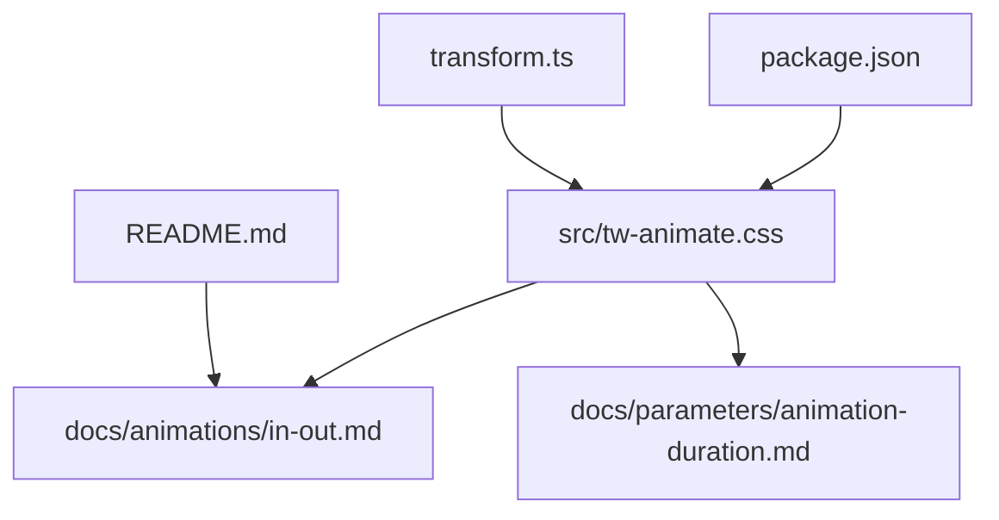

# Wombosvideo/tw-animate-css

> Tailwind CSS v4 animation utilities in pure CSS, replacing the tailwindcss-animate plugin.

## The problem
Tailwind's legacy animation plugin relies on the old JavaScript plugin system, incompatible with v4's CSS-first architecture.

## What it actually does
A single CSS file (src/tw-animate.css) imported by Tailwind: enter and exit classes (fade, zoom, slide, rotate, blur), duration, delay and repeat parameters, plus accordion-down, collapsible and caret-blink. Unused classes are pruned at build time.

## How it is wired


## Trying it
```bash
npm install -D tw-animate-css
```
Then `@import "tw-animate-css";` in app.css or globals.css.

## Cost and gotchas
Free. An announced v2.0.0 breaks compatibility (a migration script is promised). Not a strictly identical replacement for the old plugin.

## What it is not
Not a JavaScript animation library: CSS classes only.

## Alternatives
tailwindcss-animate, the original plugin this package replaces.

## For you
Ignore: used to dress up a web interface; useful only if you build a dashboard with Tailwind v4.
