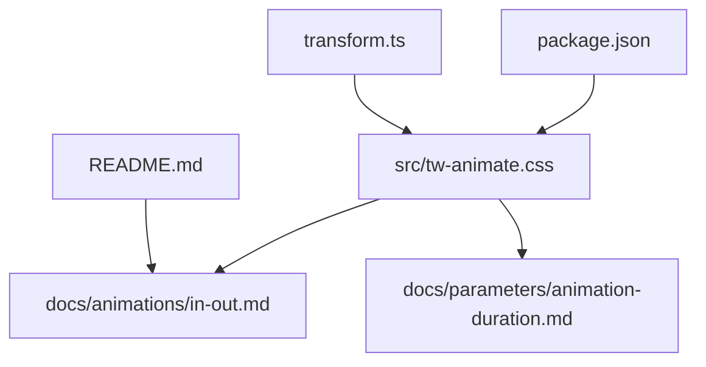

# Wombosvideo/tw-animate-css

> Utilitaires d'animation Tailwind CSS v4 en CSS pur, remplaçant le plugin tailwindcss-animate.

## Le problème
Le plugin d'animation historique de Tailwind repose sur l'ancien système de plugins JavaScript, incompatible avec l'architecture CSS d'abord de la v4.

## Ce que ça fait vraiment
Un fichier CSS unique (src/tw-animate.css) importé par Tailwind : classes d'entrée et de sortie (fondu, zoom, glissement, rotation, flou), paramètres de durée, délai et répétition, plus accordion-down, collapsible et caret-blink. Les classes inutilisées sont élaguées au build.

## Comment c'est branché


## Essayer
```bash
npm install -D tw-animate-css
```
Puis `@import "tw-animate-css";` dans app.css ou globals.css.

## Coût et pièges
Gratuit. Une v2.0.0 annoncée casse la compatibilité (script de migration promis). Pas un remplacement strictement identique de l'ancien plugin.

## Ce que ce n'est pas
Pas une bibliothèque d'animation JavaScript : uniquement des classes CSS.

## Alternatives
tailwindcss-animate, le plugin d'origine que ce paquet remplace.

## Pour toi
Ignorer : sert à habiller une interface web ; utile seulement si tu construis un tableau de bord avec Tailwind v4.

