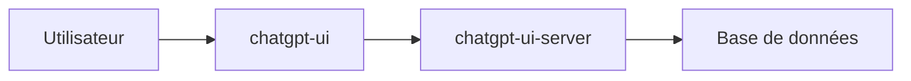

# WongSaang/chatgpt-ui

> ChatGPT-style web chat client, multi-user and multilingual, with a choice of databases.

## The problem
Giving several people a chat interface on an OpenAI model, with history kept on the server side.

## What it actually does
The very short README describes a multi-user, multilingual web client with several database connections for persistence. The server is a separate repository (`chatgpt-ui-server`). The rest is deferred to documentation in English and Chinese, not provided here.

## How it is wired

Simplified diagram based on the sheet, no diagram provided.

## Trying it
No command in the README: installation is deferred to the documentation.

## Cost and gotchas
You need the server repository in addition, and probably a model API key (not specified: undocumented). Insufficient README material.

## What it is not
Not a standalone application: the client alone does nothing without the server. Nothing is said about which models are supported.

## Alternatives
No alternative named in the README.

## For you
Worth watching without urgency: too little documented in the README to judge, and the interface depends on a third-party server to deploy.
