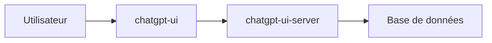

# WongSaang/chatgpt-ui

> Client web de chat type ChatGPT, multi-utilisateurs et multilingue, avec bases de données au choix.

## Le problème
Donner à plusieurs personnes une interface de chat sur un modèle OpenAI, avec historique conservé côté serveur.

## Ce que ça fait vraiment
Le README, très court, décrit un client web multi-utilisateurs, multilingue, avec plusieurs connexions de bases de données pour la persistance. Le serveur est un dépôt séparé (`chatgpt-ui-server`). Le reste est renvoyé à une documentation en anglais et en chinois, non fournie ici.

## Comment c'est branché

Schéma simplifié d'après la fiche, sans diagramme fourni.

## Essayer
Aucune commande dans le README : l'installation est renvoyée à la documentation.

## Coût et pièges
Il faut le dépôt serveur en plus, et probablement une clé d'API de modèle (non précisé : non documenté). Matière du README insuffisante.

## Ce que ce n'est pas
Pas une application autonome : le client seul ne fait rien sans le serveur. Rien n'est dit sur les modèles pris en charge.

## Alternatives
Aucune alternative nommée dans le README.

## Pour toi
À surveiller sans urgence : trop peu documenté dans le README pour juger, et l'interface dépend d'un serveur tiers à déployer.

