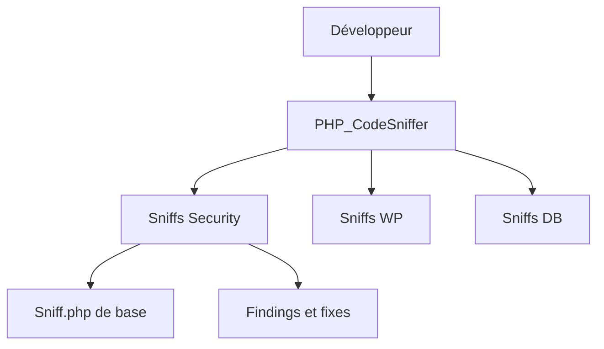

# WordPress/WordPress-Coding-Standards

> PHP_CodeSniffer rules that check PHP code against WordPress conventions and security practices.

## The problem
WordPress theme or plugin code quickly accumulates style inconsistencies, forgotten escaping and discouraged calls.

## What it actually does
A set of "sniffs" for PHPCS: arrays, whitespace, database, security (output escaping), naming, WordPress APIs, internationalization. Rulesets `WordPress`, `WordPress-Core`, `WordPress-Docs`, `WordPress-Extra`. Some violations can be fixed automatically. An optional tool replaces a text domain.

## How it is wired
Diagram based on the code's diagram.



## Trying it
```bash
composer config allow-plugins.dealerdirect/phpcodesniffer-composer-installer true
composer require --dev wp-coding-standards/wpcs:"^3.0"
vendor/bin/phpcs -ps . --standard=WordPress
```

## Cost and gotchas
Free. Requires PHP 7.2 or higher with extensions, and Composer. The project is seeking funding.

## What it is not
Not a complete security scanner: it flags conventions and common risks.

## Alternatives
VIP Coding Standards for projects deployed on WordPress VIP; PHPCompatibility as a complement.

## For you
Ignore: aimed at PHP/WordPress developers.
