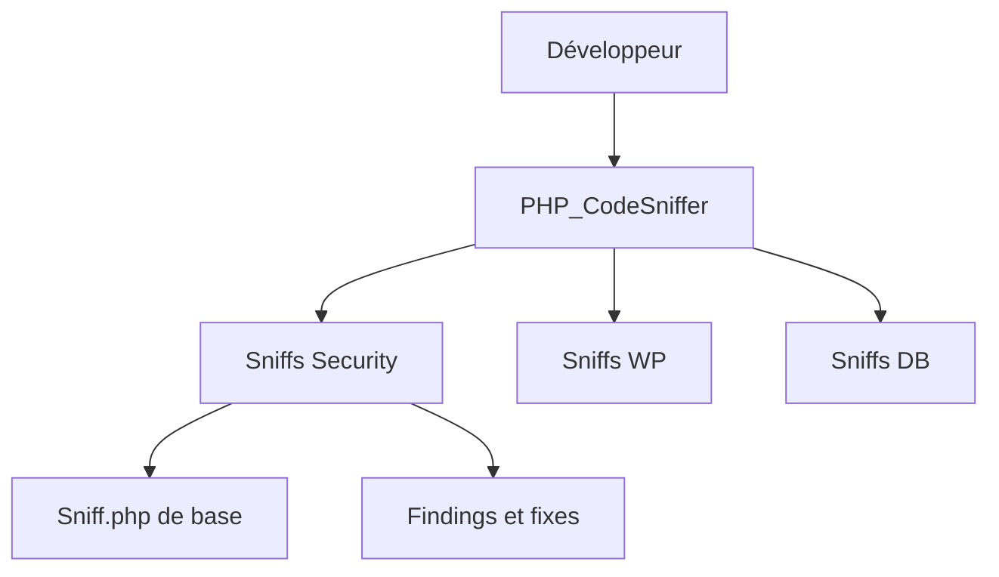

# WordPress/WordPress-Coding-Standards

> Règles PHP_CodeSniffer qui vérifient qu'un code PHP respecte les conventions et la sécurité de WordPress.

## Le problème
Un code de thème ou de plugin WordPress mélange vite styles, échappements oubliés et appels déconseillés.

## Ce que ça fait vraiment
Ensemble de « sniffs » pour PHPCS : tableaux, espaces, base de données, sécurité (échappement de sortie), nommage, API WordPress, internationalisation. Jeux de règles `WordPress`, `WordPress-Core`, `WordPress-Docs`, `WordPress-Extra`. Certains défauts sont corrigeables automatiquement. Un outil optionnel remplace un text domain.

## Comment c'est branché
Schéma d'après le diagramme du code.



## Essayer
```bash
composer config allow-plugins.dealerdirect/phpcodesniffer-composer-installer true
composer require --dev wp-coding-standards/wpcs:"^3.0"
vendor/bin/phpcs -ps . --standard=WordPress
```

## Coût et pièges
Gratuit. Exige PHP 7.2 ou plus avec extensions et Composer. Le projet cherche du financement.

## Ce que ce n'est pas
Pas un scanner de sécurité complet : il signale des conventions et des risques courants.

## Alternatives
VIP Coding Standards pour les projets déployés sur WordPress VIP ; PHPCompatibility en complément.

## Pour toi
À ignorer : réservé aux développeurs PHP/WordPress.

