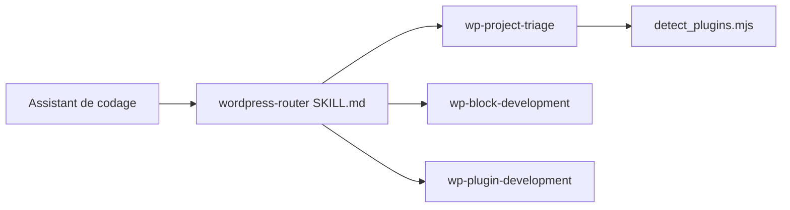

# WordPress/agent-skills

> Skills that teach coding assistants WordPress development best practices.

## The problem
Assistants generate outdated WordPress patterns, omit plugin security, or break Gutenberg blocks.

## What it actually does
Eighteen skills: repository router, project triage, Gutenberg blocks, block themes, plugins, REST API, Interactivity API, Abilities API (with audit and verification), WP-CLI, performance, PHPStan, Playground, Blueprints, `wp-env`. Each skill contains a `SKILL.md`, references and detection scripts. The README states that the skills were generated with GPT-5.2 Codex and then reviewed by contributors.

## How it is wired


## Trying it
```bash
npx skills add WordPress/agent-skills --skill wp-plugin-development
npx skills add WordPress/agent-skills --list
node shared/scripts/skillpack-install.mjs --global
```

## Cost and gotchas
Free. Stated compatibility: WordPress 7.0+ (PHP 7.4+). A license is present but not identified by GitHub. Version 1, with fixes expected from the community.

## What it is not
Not a WordPress environment: a set of instructions. Quality depends on human review of AI-generated text.

## Alternatives
No alternative named in the README.

## For you
Ignore: WordPress-specific, unrelated to data/AI/MLOps; only the way it splits into skills (router, triage, detection scripts) may inspire your own.
