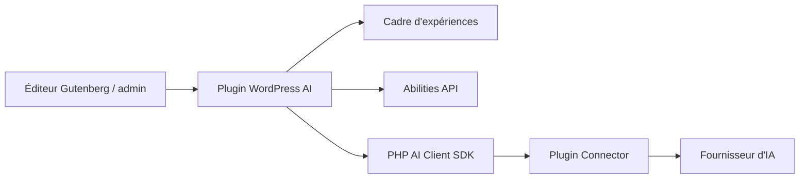

# WordPress/ai

> WordPress plugin offering optional AI features for authors and admins, also serving as a reference for developers.

## The problem
WordPress sites have no common framework for plugging in AI providers and offering editorial features without hacks.

## What it actually does
Provides a framework of experiments that can be enabled one by one, with about thirty features: alt text, titles, excerpts, summaries, translation, classification, editorial notes, image generation and editing, comment moderation, meta descriptions, request log, API key encryption. Relies on the Abilities API and the PHP AI client. No key provided: you need a Connector plugin (Anthropic, Google, OpenAI...).

## How it is wired


## Trying it
```bash
# Aucune commande documentée dans ce README.
# Étapes décrites : installer le plugin, installer un plugin Connector,
# configurer ses identifiants dans Réglages > Connecteurs.
```

## Cost and gotchas
Calls to providers are at your expense via the connector. The README advises against production: "experimental, may change or break". 108 open issues. Features remain unavailable until a connector is authenticated.

## What it is not
Not a provider or a model: it contains no provider implementation. Not a WordPress core feature, only a candidate evaluated under the "Features as Plugins" model.

## Alternatives
No alternative named in the README.

## For you
Worth watching if you run a WordPress site or design editorial workflows; its experimental status still rules out production use.
