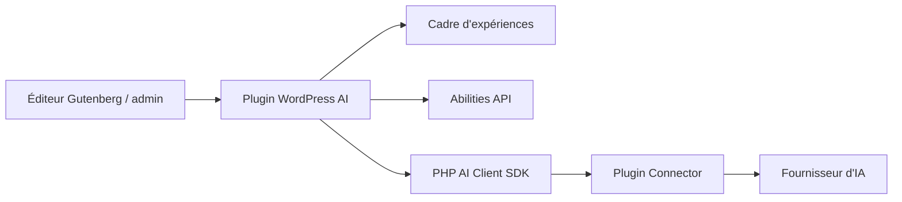

# WordPress/ai

> Plugin WordPress de fonctions d'IA optionnelles pour auteurs et admins, qui sert aussi de référence aux développeurs.

## Le problème
Les sites WordPress n'ont pas de cadre commun pour brancher des fournisseurs d'IA et proposer des fonctions éditoriales sans bricolage.

## Ce que ça fait vraiment
Fournit un cadre d'expériences activables une à une, avec une trentaine de fonctions : texte alternatif, titres, extraits, résumés, traduction, classification, notes éditoriales, génération et édition d'images, modération de commentaires, méta-descriptions, journal des requêtes, chiffrement des clés d'API. S'appuie sur l'API Abilities et le client PHP AI. Aucune clé fournie : il faut un plugin Connector (Anthropic, Google, OpenAI…).

## Comment c'est branché


## Essayer
```bash
# Aucune commande documentée dans ce README.
# Étapes décrites : installer le plugin, installer un plugin Connector,
# configurer ses identifiants dans Réglages > Connecteurs.
```

## Coût et pièges
Les appels aux fournisseurs sont à ta charge via le connecteur. Le README déconseille la production : « expérimental, peut changer ou casser ». 108 issues ouvertes. Les fonctions restent indisponibles tant qu'un connecteur n'est pas authentifié.

## Ce que ce n'est pas
Pas un fournisseur ni un modèle : il ne contient aucune implémentation de fournisseur. Pas une fonction du cœur de WordPress, seulement un candidat évalué selon le modèle « Features as Plugins ».

## Alternatives
Aucune alternative nommée dans le README.

## Pour toi
À surveiller si tu gères un site WordPress ou conçois des workflows éditoriaux ; son statut expérimental interdit encore de l'utiliser en production.

