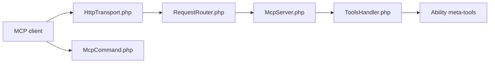

# WordPress/mcp-adapter

> Official WordPress package that exposes WordPress "abilities" as MCP tools, resources and prompts.

## The problem
An AI agent has no standard way to act on a WordPress site or to read its functions.

## What it actually does
Converts the abilities of the WordPress Abilities API into MCP tools, resources and prompts. HTTP (`/wp-json/mcp/mcp-adapter-default-server`) and STDIO transports via WP-CLI, multiple servers, replaceable error handling and observability, permissions per server and per ability. Abilities are private by default (`meta.public`).

## How it is wired


## Trying it
```text
Quick Start Guide : enregistrer une ability puis l'exposer via MCP
Point HTTP : /wp-json/mcp/mcp-adapter-default-server
```
No specific installation command is given in the provided README.

## Cost and gotchas
Free; assumes a WordPress site with the Abilities API. The v0.3, v0.5 and v0.7 migrations indicate an API that is still moving.

## What it is not
Not an agent or an MCP client: only the WordPress-side gateway. Exposing an ability gives the agent real access to the site.

## Alternatives
No alternative named in the README.

## For you
Worth watching: a solid reference if you connect agents to WordPress, but the API is evolving and it is GPL-2.0.
