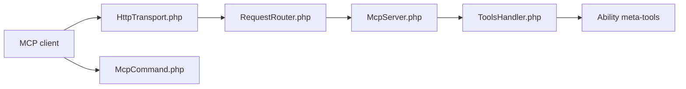

# WordPress/mcp-adapter

> Paquet officiel WordPress qui expose les « abilities » de WordPress comme outils, ressources et prompts MCP.

## Le problème
Un agent IA n'a pas de moyen standard d'agir sur un site WordPress ni d'en lire les fonctions.

## Ce que ça fait vraiment
Convertit les abilities de l'API Abilities de WordPress en outils, ressources et prompts MCP. Transports HTTP (`/wp-json/mcp/mcp-adapter-default-server`) et STDIO via WP-CLI, plusieurs serveurs, gestion d'erreurs et observabilité remplaçables, permissions par serveur et par ability. Les abilities sont privées par défaut (`meta.public`).

## Comment c'est branché


## Essayer
```text
Quick Start Guide : enregistrer une ability puis l'exposer via MCP
Point HTTP : /wp-json/mcp/mcp-adapter-default-server
```
Aucune commande d'installation précise n'est donnée dans le README fourni.

## Coût et pièges
Gratuit ; suppose un site WordPress avec l'API Abilities. Les migrations v0.3, v0.5 et v0.7 indiquent une API encore mouvante.

## Ce que ce n'est pas
Pas un agent ni un client MCP : seulement la passerelle côté WordPress. Exposer une ability donne à l'agent un accès réel au site.

## Alternatives
Aucune alternative nommée dans le README.

## Pour toi
À surveiller : référence solide si tu connectes des agents à WordPress, mais API en évolution et GPL-2.0.

