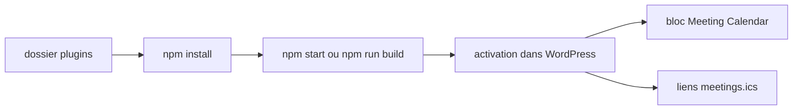

# WordPress/meeting-calendar

> WordPress plugin that schedules recurring meetings and displays them as a calendar or a time grid.

## The problem
A WordPress community has to publish a calendar of recurring meetings without hacking together a third-party plugin.

## What it actually does
Lets you create recurring meetings and adds a `Meeting Calendar` block to insert in a page or post. Calendars are also exposed as `.ics` links. Development goes through `npm` and an optional `wp-env` environment.

## How it is wired
Simplified diagram based on the sheet, no diagram provided.



## Trying it
```bash
npm install
npm start
npm run wp-env start
composer install
npm run test:unit-php
```

## Cost and gotchas
Free. Requires git, Node and npm, plus PHP and Composer for the tests, and an existing WordPress. GPL-3.0 license, copyleft, with no effect for simple use.

## What it is not
Not a room booking or video conferencing tool: it is a calendar display.

## Alternatives
No alternative named in the README.

## For you
Ignore: a WordPress calendar plugin, unrelated to data, AI or MLOps.
