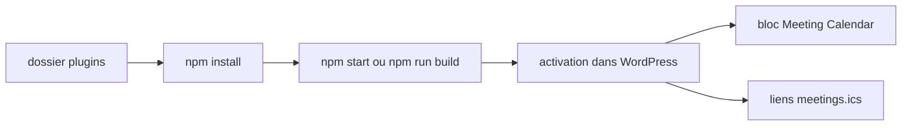

# WordPress/meeting-calendar

> Extension WordPress qui planifie des réunions récurrentes et les affiche en calendrier ou en grille horaire.

## Le problème
Une communauté WordPress doit publier un calendrier de réunions récurrentes sans bricoler un plugin tiers.

## Ce que ça fait vraiment
Permet de créer des réunions récurrentes et ajoute un bloc `Meeting Calendar` à insérer dans une page ou un article. Les calendriers sortent aussi en liens `.ics`. Le développement passe par `npm` et un environnement `wp-env` en option.

## Comment c'est branché
Schéma simplifié d'après la fiche, sans diagramme fourni.



## Essayer
```bash
npm install
npm start
npm run wp-env start
composer install
npm run test:unit-php
```

## Coût et pièges
Gratuit. Demande git, Node et npm, plus PHP et Composer pour les tests, et un WordPress existant. Licence GPL-3.0, de type copyleft, sans effet pour un simple usage.

## Ce que ce n'est pas
Pas un outil de réservation de salles ni de visioconférence : c'est un affichage de calendrier.

## Alternatives
Aucune alternative nommée dans le README.

## Pour toi
À ignorer : plugin WordPress de calendrier, sans rapport avec les données, l'IA ou le MLOps.

