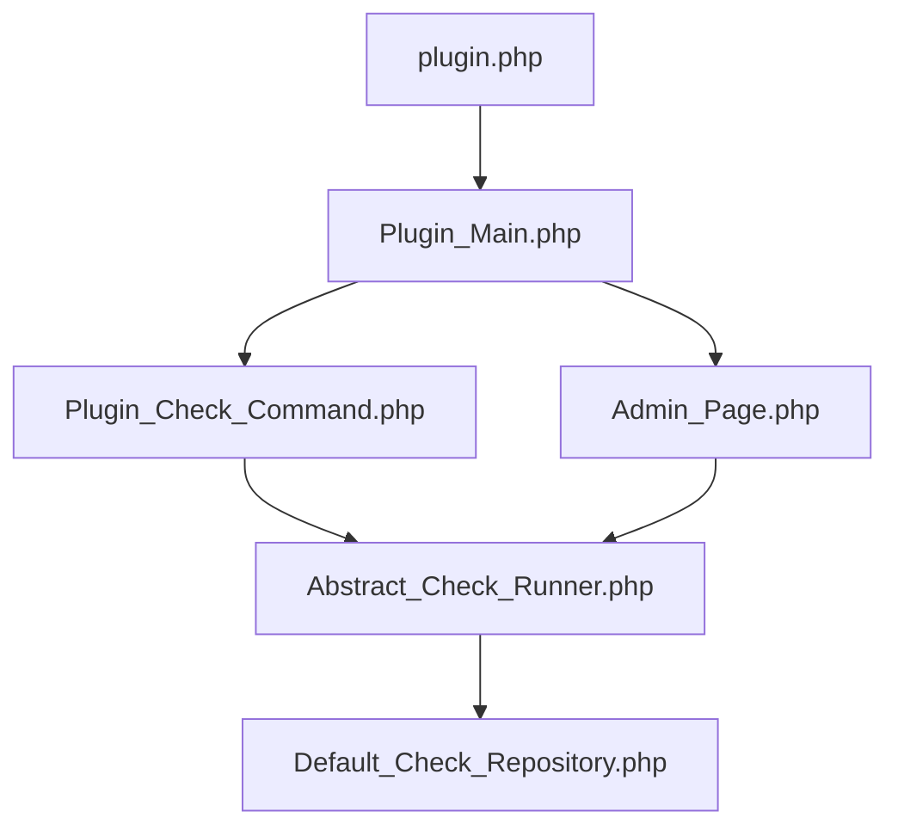

# WordPress/plugin-check

> WordPress plugin that analyzes another plugin to check the WordPress.org directory rules.

## The problem
A plugin author cannot know in advance whether their code will meet the WordPress.org requirements.

## What it actually does
Plugin Check analyzes an installed plugin from the Tools admin screen or with `wp plugin check`. It chains static checks (PHP_CodeSniffer, regular expressions) and runtime checks (WordPress hooks). Developers add checks through base classes and interfaces.

## How it is wired
Diagram based on the code diagram.


## Trying it
```bash
wp plugin check hello.php
wp plugin check hello.php --require=./wp-content/plugins/plugin-check/cli.php
npm run wp-env start
npm run wp-env:start:tests
```

## Cost and gotchas
Free. You need a WordPress site; not recommended in production. Docker is required for the built-in development environment. Runtime checks need a workaround with WP-CLI.

## What it is not
It is not a full security scanner. It mostly checks compliance with the directory.

## Alternatives
No alternative named in the README.

## For you
Ignore: only useful for publishing WordPress plugins, outside your field.
