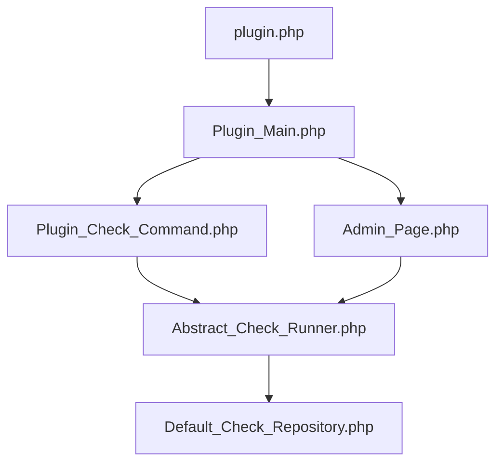

# WordPress/plugin-check

> Extension WordPress qui analyse un autre plugin pour vérifier les règles du répertoire WordPress.org.

## Le problème
Un auteur de plugin ne sait pas à l'avance si son code respectera les exigences de WordPress.org.

## Ce que ça fait vraiment
Plugin Check analyse un plugin installé depuis l'écran Outils d'administration ou avec `wp plugin check`. Il enchaîne des contrôles statiques (PHP_CodeSniffer, expressions régulières) et d'exécution (hooks WordPress). Les développeurs ajoutent des contrôles via des classes de base et des interfaces.

## Comment c'est branché
Schéma d'après le diagramme du code.


## Essayer
```bash
wp plugin check hello.php
wp plugin check hello.php --require=./wp-content/plugins/plugin-check/cli.php
npm run wp-env start
npm run wp-env:start:tests
```

## Coût et pièges
Gratuit. Il faut un site WordPress ; déconseillé en production. Docker est requis pour l'environnement de développement intégré. Les contrôles d'exécution demandent un contournement avec WP-CLI.

## Ce que ce n'est pas
Ce n'est pas un scanner de sécurité complet. Il vérifie surtout la conformité au répertoire.

## Alternatives
Aucune alternative nommée dans le README.

## Pour toi
À ignorer : ne sert qu'à publier des plugins WordPress, hors de ton domaine.

