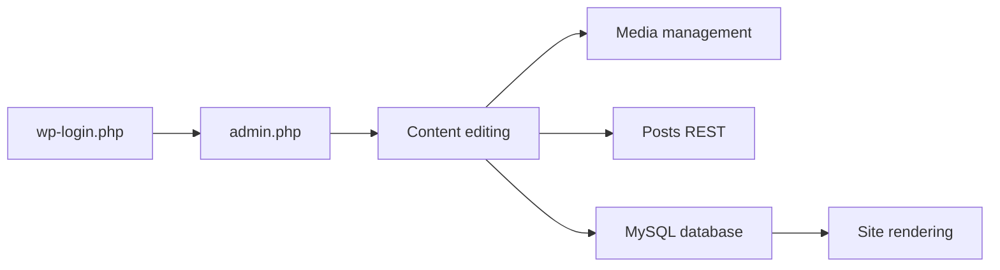

# WordPress/wordpress-develop

> Development repository for the WordPress core, for contributors who want to fix or test the CMS.

## The problem
Contributing to the core requires a reproducible PHP, MySQL and JavaScript environment.

## What it actually does
Provides a local container-based environment driven by npm (start, install, WP-CLI, PHP tests, E2E, QUnit, coverage). The code contains administration, login, media, REST, Customizer, themes, multisite and an AI client (`AiClient.php`).

## How it is wired


## Trying it
```bash
npm install
npm run build:dev
npm run env:start
npm run env:install
```

## Cost and gotchas
Node 24.x / npm 11.x and Docker. Default credentials `admin` / `password`: change them.

## What it is not
Not a production WordPress installation: it is the core development environment.

## Alternatives
- None cited in the README.

## For you
Ignore: reserved for WordPress core contributors, unrelated to data/AI.
