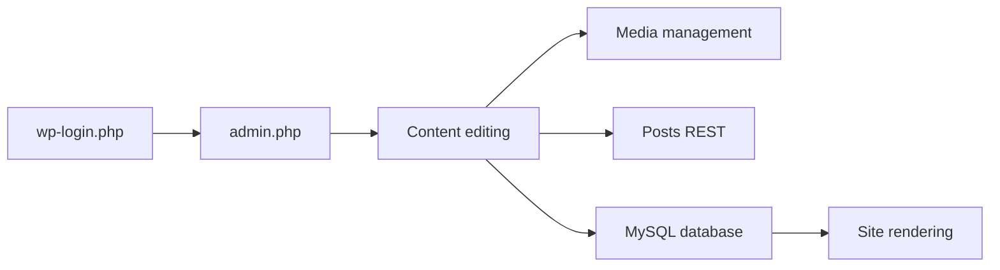

# WordPress/wordpress-develop

> Dépôt de développement du cœur de WordPress, pour contributeurs qui veulent corriger ou tester le CMS.

## Le problème
Contribuer au noyau demande un environnement PHP, MySQL et JavaScript reproductible.

## Ce que ça fait vraiment
Fournit un environnement local par conteneurs piloté par npm (démarrage, installation, WP-CLI, tests PHP, E2E, QUnit, couverture). Le code contient administration, connexion, médias, REST, Customizer, thèmes, multisite et un client IA (`AiClient.php`).

## Comment c'est branché


## Essayer
```bash
npm install
npm run build:dev
npm run env:start
npm run env:install
```

## Coût et pièges
Node 24.x / npm 11.x et Docker. Identifiants par défaut `admin` / `password` : à changer.

## Ce que ce n'est pas
Pas une installation WordPress de production : c'est l'environnement de développement du cœur.

## Alternatives
- Aucune citée dans le README.

## Pour toi
À ignorer : réservé aux contributeurs du noyau WordPress, sans rapport avec data/IA.

