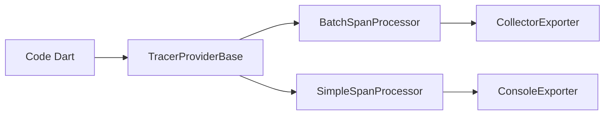

# Workiva/opentelemetry-dart

> Dart implementation of OpenTelemetry to trace Dart or Flutter applications.

## The problem
Without standard instrumentation, tracing a Dart app to an OpenTelemetry collector is impossible without rewriting the protocol.

## What it actually does
It provides an SDK to create spans, send them in batches to a collector or to the console, and propagate context between processes. Traces are in beta, metrics in alpha, logs are absent. A time provider for the browser is available.

## How it is wired
Simplified diagram based on the sheet, no diagram provided.



## Trying it
```dart
final tracerProvider = TracerProviderBase(processors: [
  BatchSpanProcessor(CollectorExporter(Uri.parse('https://my-collector.com/v1/traces'))),
  SimpleSpanProcessor(ConsoleExporter())
]);
registerGlobalTracerProvider(tracerProvider);
```

## Cost and gotchas
An OpenTelemetry collector must be provided. Dart is required, outside the list of prerequisites. Timestamps can be wrong if the machine goes to sleep.

## What it is not
It is not an observability backend: it only emits data. Logs are not implemented.

## Alternatives
No alternative named in the README.

## For you
Watch: only if you instrument Dart; in MLOps, the Python OpenTelemetry SDKs are more useful.
