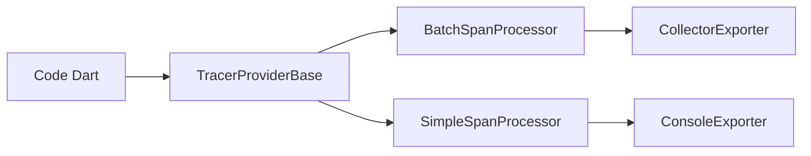

# Workiva/opentelemetry-dart

> Implémentation Dart d'OpenTelemetry pour tracer des applications Dart ou Flutter.

## Le problème
Sans instrumentation standard, tracer une appli Dart vers un collecteur OpenTelemetry est impossible sans réécrire le protocole.

## Ce que ça fait vraiment
Elle fournit un SDK pour créer des spans, les envoyer par lots à un collecteur ou à la console, et propager le contexte entre processus. Les traces sont en bêta, les métriques en alpha, les logs absents. Un fournisseur de temps pour le navigateur est disponible.

## Comment c'est branché
Schéma simplifié d'après la fiche, sans diagramme fourni.



## Essayer
```dart
final tracerProvider = TracerProviderBase(processors: [
  BatchSpanProcessor(CollectorExporter(Uri.parse('https://my-collector.com/v1/traces'))),
  SimpleSpanProcessor(ConsoleExporter())
]);
registerGlobalTracerProvider(tracerProvider);
```

## Coût et pièges
Un collecteur OpenTelemetry à fournir. Dart est requis, hors liste de prérequis. Les timestamps peuvent être faux si la machine se met en veille.

## Ce que ce n'est pas
Ce n'est pas un backend d'observabilité : il émet seulement des données. Les logs ne sont pas implémentés.

## Alternatives
Aucune alternative nommée dans le README.

## Pour toi
Surveiller : seulement si tu instrumentes du Dart ; en MLOps, les SDK Python d'OpenTelemetry sont plus utiles.

