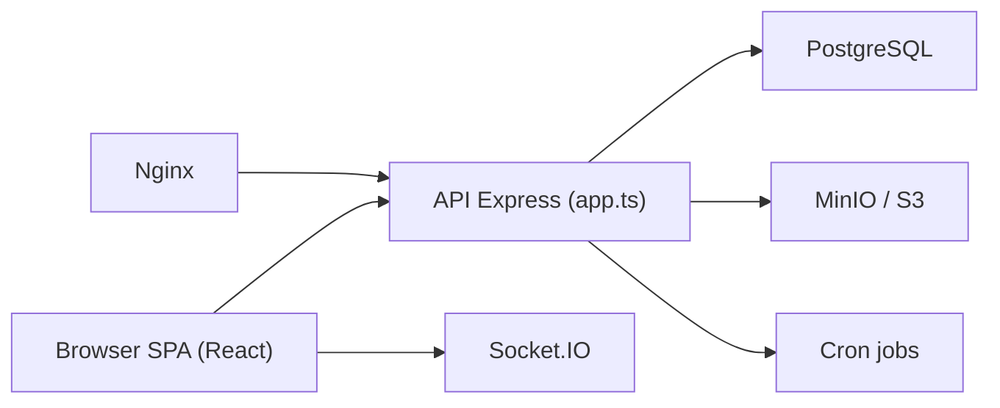

# Worklenz/worklenz

> Self-hostable project and task management tool, with time tracking and reports.

## The problem
Planning projects, tasks and team workload without going through a project management SaaS.

## What it actually does
React (Ant Design) application and TypeScript/Express backend on PostgreSQL, with Redis, S3-compatible storage (MinIO by default, Azure Blob possible) and Socket.IO for real time. Tasks (subtasks, dependencies, recurrence, comments), kanban and planning views, time tracking, reports, email notifications, cron jobs. Local or Google login (Passport).

## How it is wired


## Trying it
```bash
git clone https://github.com/Worklenz/worklenz.git
cd worklenz
docker-compose up -d
# Frontend : http://localhost:5000  Backend : http://localhost:3000
```

## Cost and gotchas
Free when self-hosted. Default MinIO credentials minioadmin/minioadmin must be changed. Google Analytics is enabled on consent (opt-in, according to the README). The license is present but not identified by GitHub: read it before reuse.

## What it is not
Not a data/ML tool: it is a general-purpose project manager, with billing plans on the code side.

## Alternatives
Not documented in the README.

## For you
Ignore: unrelated to your data/AI work, and the unidentified license is a drawback.
