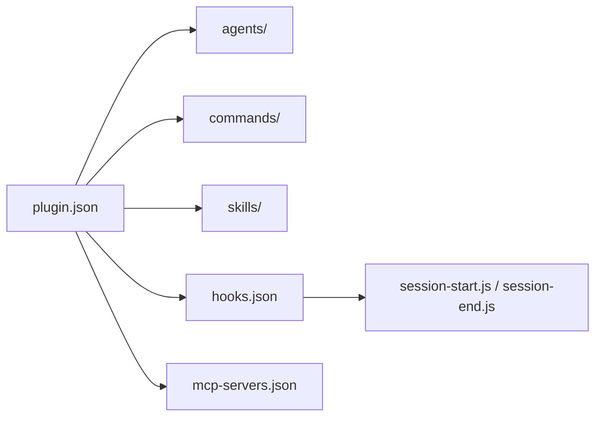

# WorldFlowAI/everything-claude-code

> Claude Code configs (agents, skills, hooks, rules, MCP) from a hackathon winner, packaged as a plugin.

## The problem
Starting from scratch to configure Claude Code sub-agents, commands and hooks takes time.

## What it actually does
Plugin with nine sub-agents (planner, architect, code-reviewer, security-reviewer…), skills (TDD, backend-patterns, continuous-learning, eval-harness…), slash commands (`/tdd`, `/plan`, `/verify`…), rules, Node.js hooks (session saving, compaction suggestion) and package manager detection. The code is only the raw part: the explanations are in two external guides.

## How it is wired


## Trying it
```bash
/plugin marketplace add affaan-m/everything-claude-code
/plugin install everything-claude-code@everything-claude-code
```

## Cost and gotchas
Free. Warning: this repo (WorldFlowAI) appears to be a copy of `affaan-m/everything-claude-code` (created and pushed the same day, 2026-01-23, no license declared); the README commands point to the original. The README warns that enabling too many MCPs reduces the context window.

## What it is not
Not a ready-made configuration for your stack: the author himself writes that these are his preferences, to be adapted.

## Alternatives
The original repo `affaan-m/everything-claude-code`, cited in the README.

## For you
Ignore this frozen, unlicensed copy; if the idea interests you, start from the original and pick skill by skill.
