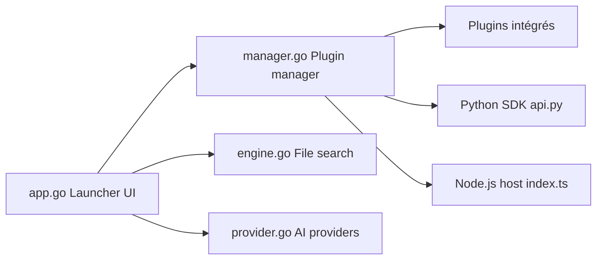

# Wox-launcher/Wox

> Native keyboard launcher for Windows, macOS and Linux, extensible through plugins, an alternative to Raycast and Alfred.

## The problem
Open apps, files and actions without leaving the keyboard, across several operating systems.

## What it actually does
A single input box for local search and actions. Native GPU rendering (not Electron), about 150 MB of memory according to the README. Built-in plugins, or plugins in Node.js, Python and scripts from a store. The code also shows indexed file search, AI providers, themes and cloud sync.

## How it is wired


## Trying it
```bash
brew install --cask wox
winget install -e --id Wox.Wox
scoop install extras/wox
choco install wox
yay -S wox-bin
```

## Cost and gotchas
Free. AI features rely on external providers; sync goes through a Wox cloud account (not detailed). GPL-3.0 license.

## What it is not
Not a data tool; the memory figures are the author's own. The full runtime wiring has not been verified.

## Alternatives
- Raycast: alternative named in the README.
- Alfred: same, macOS-only.

## For you
Keep an eye on it: workstation comfort, no value for a pipeline; keep GPL-3.0 in mind if you write plugins that you redistribute.
