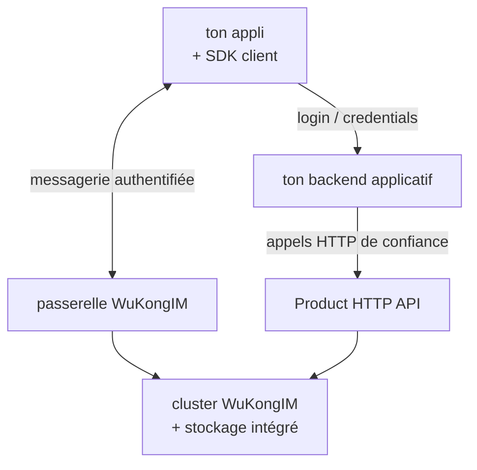

# WuKongIM/WuKongIM

> Self-hosted messaging server for chats, groups and notifications, storage and cluster included.

## The problem
Adding messaging to an app usually means an external database, cache and message queue, plus offline sync and multi-device support to write yourself.

## What it actually does
Handles message storage, synchronization, presence and online delivery; the app provides the interface, accounts and business rules. Storage of messages, metadata and replication is built in: the core needs no external database, cache or queue. A single cluster model, from a single node to multiple nodes, with 256 hash slots by default. Brings per-channel ordering, offline sync, multi-device sessions, and personal, group or custom channels. Ships a chat demo, a Manager, metrics, diagnostics and backup tools.

## How it is wired


## Trying it
```bash
curl -fsSL https://packages.githubim.com/repo | sudo sh
sudo apt update && sudo apt install -y wukongim
wukongim version
sudo wukongim init
sudo wukongim config validate --config /etc/wukongim/wukongim.toml
sudo systemctl enable --now wukongim
curl --retry 30 --retry-delay 2 --retry-all-errors --max-time 5 --fail http://127.0.0.1:5001/readyz
sudo journalctl -u wukongim -n 100 --no-pager
```

## Cost and gotchas
Free. The Manager administrator password is displayed **only once** at initialization. The package only covers amd64 on a closed list of distributions. The Product HTTP API has **no business-caller authentication**: it must stay behind a trusted backend.

## What it is not
Not a chat app: no UI, no accounts, no media storage, no group/friends logic. Not stable: v3 is in beta, and APIs, configuration and durable formats are announced as subject to change. The cited performance report concerns a historical three-process setup on a single host, not the current version.

## Alternatives
No named alternative: the README only contrasts its two SDKs (full WuKongIMSDK versus lightweight WuKongEasySDK), and flags the old UniApp SDK as abandoned.

## For you
Out of scope for data / AI; only worth noting if a client project calls for sovereign messaging.
