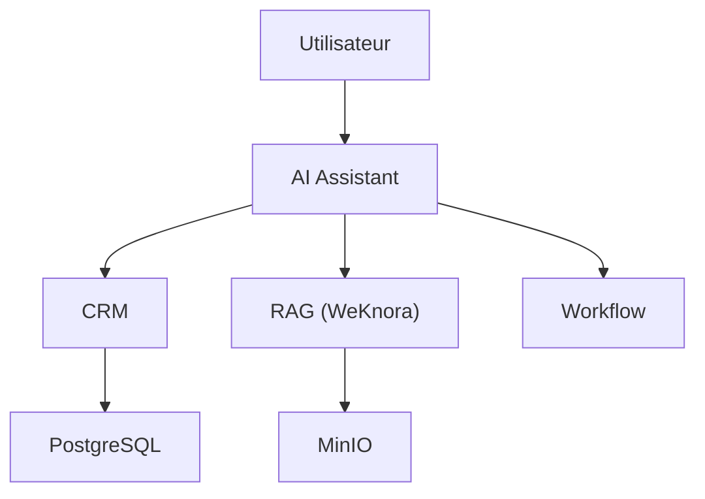

# WuKongOpenSource/Wukong-AICRM

> Team CRM with an AI assistant, a RAG knowledge base and tasks, for SMEs with private deployment.

## The problem
Sales teams scatter customers, tasks, documents and emails, and search by hand for the useful information before each follow-up.

## What it actually does
Conversational assistant querying customers, performance and the document base; RAG over manuals, contracts and proposals; customer records with risk detection; task generation; Gmail, Outlook and IMAP/SMTP integration. Java 21, Spring Boot, Spring AI, PostgreSQL, Redis, MinIO backend; Vue 3 frontend. OpenAI-API-compatible models. The README is in Chinese and English.

## How it is wired


## Trying it
```bash
git clone https://github.com/WuKongOpenSource/Wukong-AICRM.git
cd Wukong-AICRM/docker
docker-compose up -d
```

## Cost and gotchas
An API key from a model provider is mandatory, otherwise the chat fails; a connection to a WeKnora service is needed for the knowledge base. The code is open for non-commercial purposes: any commercial or production use requires a separate license.

## What it is not
Not free software in the usual sense: production use is subject to authorization. Not a product you can test without a cloud account for the demo.

## Alternatives
No alternative named in the README.

## For you
Ignore: non-commercial license and a business-specific CRM; the Spring AI/RAG stack offers no reusable building block.
