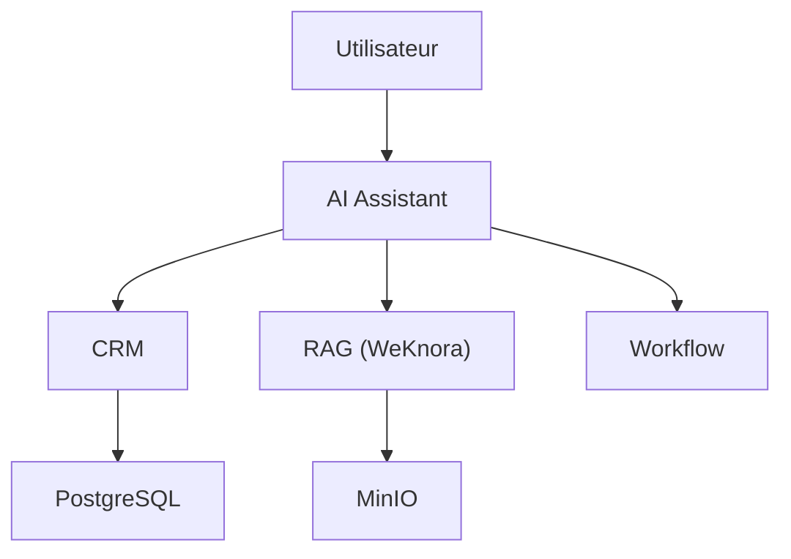

# WuKongOpenSource/Wukong-AICRM

> CRM d'équipe avec assistant IA, base de connaissances RAG et tâches, pour PME en déploiement privé.

## Le problème
Les équipes commerciales dispersent clients, tâches, documents et courriels, et cherchent à la main l'information utile avant chaque relance.

## Ce que ça fait vraiment
Assistant conversationnel interrogeant clients, performances et base documentaire ; RAG sur manuels, contrats et propositions ; fiches clients avec détection de risques ; génération de tâches ; liaison Gmail, Outlook et IMAP/SMTP. Backend Java 21, Spring Boot, Spring AI, PostgreSQL, Redis, MinIO ; frontend Vue 3. Modèles compatibles API OpenAI. Le README est en chinois et en anglais.

## Comment c'est branché


## Essayer
```bash
git clone https://github.com/WuKongOpenSource/Wukong-AICRM.git
cd Wukong-AICRM/docker
docker-compose up -d
```

## Coût et pièges
Clé d'API d'un fournisseur de modèles obligatoire, sinon le chat échoue ; connexion à un service WeKnora pour la base de connaissances. Le code est ouvert à des fins non commerciales : tout usage commercial ou en production exige une licence séparée.

## Ce que ce n'est pas
Pas un logiciel libre au sens usuel : l'usage en production est soumis à autorisation. Pas un produit testable sans compte cloud pour la démo.

## Alternatives
Aucune alternative nommée dans le README.

## Pour toi
À ignorer : licence non commerciale et CRM métier ; la pile Spring AI/RAG n'apporte pas de brique réutilisable.

