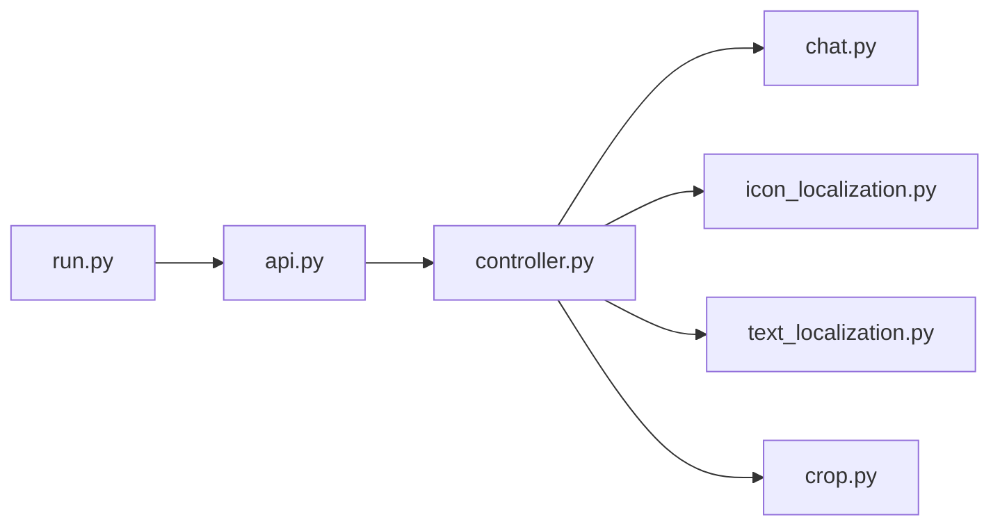

# X-PLUG/MobileAgent

> Family of GUI agents from Tongyi Lab (Alibaba) for driving phones, PCs and the web.

## The problem
Getting a model to carry out real tasks in mobile or desktop applications (booking, comparing, filling in a document) remains difficult and unreliable.

## What it actually does
The README is an index of works: Mobile-Agent v1 to v3.5, Mobile-Agent-E, PC-Agent, UI-S1 (semi-online RL), GUI-Critic-R1, and the GUI-Owl 7B/32B/1.5 models published on Hugging Face. Each subfolder holds its own code. Judging from the architecture, the variants share `api`, `chat`, `controller` modules, plus icon and text localization. PC and phone demos are described, and the Bailian API is offered.

## How it is wired

(Supplied diagram unreadable: nodes taken from the explanation.)

## Trying it
No command is documented in the root README: installation is found in each subfolder.

## Cost and gotchas
7B to 32B models: you need a GPU to serve them locally, or the Bailian API (Alibaba Cloud). Driving a phone requires a connected device.

## What it is not
Not a single ready-to-use tool: a collection of heterogeneous research projects, each with its own installation.

## Alternatives
No alternative is named in the README.

## For you
Worth watching to follow the state of the art in GUI agents and the open GUI-Owl models, but the root README gives nothing executable: you have to dive into each sub-project.
