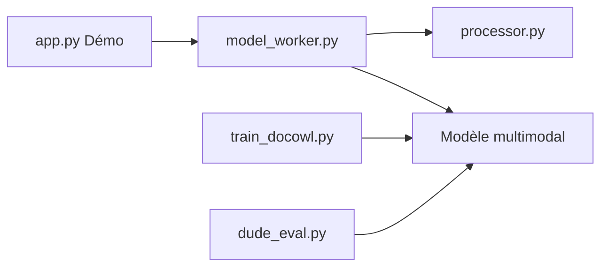

# X-PLUG/mPLUG-DocOwl

> Alibaba family of multimodal models for understanding documents, charts and diagrams without OCR.

## The problem
Reading documents, tables and charts through OCR and then a language model loses the layout and adds errors.

## What it actually does
The README is short: it lists six models (DocOwl2, DocOwl1.5, TinyChart, PaperOwl, UReader, DocOwl) with their papers (EMNLP, ACM MM, arXiv), and points to Hugging Face and ModelScope demos. The architecture, based on the code, shows demos, generation workers, fine-tuning and evaluation scripts (DUDE, DUE) per sub-project.

## How it is wired

## Trying it
No command documented in this README: use the online demos or the README of each sub-project (not provided here).

## Cost and gotchas
The weights must be fetched separately; the required hardware is not stated in this README. The Hugging Face demo is less stable than the ModelScope one (ZeroGPU, GPU allocated dynamically). 73 open issues.

## What it is not
Not an installable package with a single API: it is a research repository grouping several projects. Last push in May 2025. The announced performance figures are not in this text.

## Alternatives
No alternative named in the README.

## For you
Worth watching: relevant for document extraction without OCR, but you have to read the sub-projects to evaluate it, and the repository is barely active.
