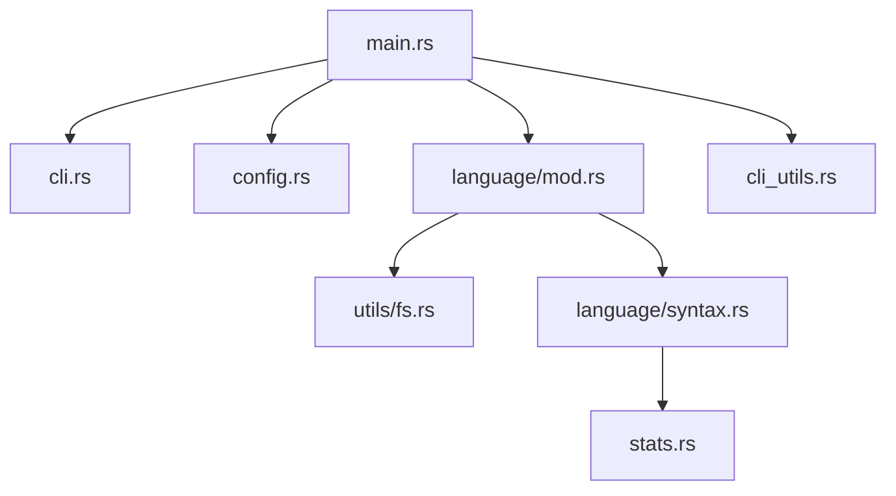

# XAMPPRocky/tokei

> Command-line tool that counts files, lines of code, comments and blank lines per language.

## The problem
Knowing the real size of a codebase, per language, without counting comments and blank lines as code.

## What it actually does
Walks through folders while respecting `.gitignore`, `.ignore` and `.tokeignore`, classifies lines (code, comments, blanks) for more than 150 languages, handles nested comments and embedded languages. Outputs a table, JSON, YAML or CBOR (depending on compile options) and can re-read a previous output. Also usable as a Rust library.

## How it is wired


## Trying it
```bash
cargo install tokei
tokei ./foo
tokei ./foo --sort code
tokei ./foo --output json
```

## Cost and gotchas
Free. The JSON, YAML and CBOR formats require `cargo install tokei --features all` (the README warns about a build compiled without serialization). `.d` files generated by gcc skew the D language count: exclude them with `-e *.d`.

## What it is not
It is not a code quality or complexity tool: it only counts lines. License present but not identified by GitHub.

## Alternatives
- tokei-pie: cited as a companion tool, to display the output as an interactive chart.

## For you
Adopt: one command to measure a repository before auditing it or estimating an analysis cost, provided you check the license before redistribution.
