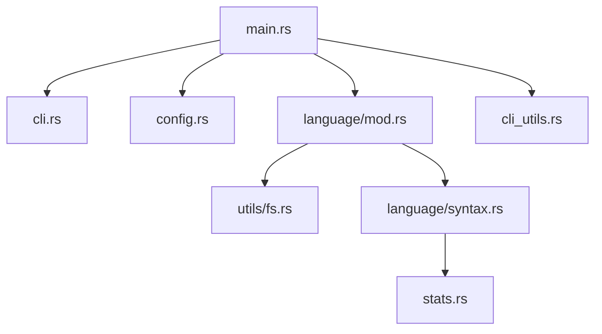

# XAMPPRocky/tokei

> Outil en ligne de commande qui compte fichiers, lignes de code, commentaires et lignes vides par langage.

## Le problème
Connaître la taille réelle d'une base de code, par langage, sans compter les commentaires et lignes vides comme du code.

## Ce que ça fait vraiment
Parcourt des dossiers en respectant `.gitignore`, `.ignore` et `.tokeignore`, classe les lignes (code, commentaires, vides) pour plus de 150 langages, gère les commentaires imbriqués et les langages incorporés. Sort en tableau, JSON, YAML ou CBOR (selon les options de compilation) et relit une sortie précédente. Utilisable aussi comme bibliothèque Rust.

## Comment c'est branché


## Essayer
```bash
cargo install tokei
tokei ./foo
tokei ./foo --sort code
tokei ./foo --output json
```

## Coût et pièges
Gratuit. Les formats JSON, YAML et CBOR demandent `cargo install tokei --features all` (le README signale une version compilée sans sérialisation). Les fichiers `.d` générés par gcc faussent le compte du langage D : les exclure avec `-e *.d`.

## Ce que ce n'est pas
Ce n'est pas un outil de qualité de code ni de complexité : il compte seulement des lignes. Licence présente mais non identifiée par GitHub.

## Alternatives
- tokei-pie : cité en outil associé, pour afficher la sortie en graphique interactif.

## Pour toi
À adopter : une commande pour mesurer un dépôt avant de l'auditer ou d'estimer un coût d'analyse, à condition de vérifier la licence avant redistribution.

