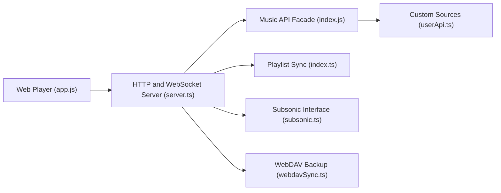

# XCQ0607/lxserver

> Node.js sync server for LX Music with a web player and Subsonic protocol, documented in Chinese.

## The problem
Syncing playlists and favorites between LX Music clients and listening from a browser.

## What it actually does
An Express/WebSocket server that syncs playlists and "dislikes" from LX Music clients, serves a web player (multi-source search, cache, lyrics, sharing) and exposes a Subsonic interface. WebDAV backup, importable custom sources, optional public library, password-protected access.

## How it is wired


## Trying it
```bash
docker run -d -p 9527:9527 -v $(pwd)/data:/server/data -v $(pwd)/logs:/server/logs -v $(pwd)/cache:/server/cache -v $(pwd)/music:/server/music --name lx-sync-server --restart unless-stopped xcq0607/lxserver:latest
git clone https://github.com/XCQ0607/lxserver.git && cd lxserver
npm ci && npm run build
npm start
```

## Cost and gotchas
Default admin password `123456` must be changed. Anonymous PostHog statistics are on by default (`DISABLE_TELEMETRY=true` to turn them off). Apache-2.0 license supplemented by a notice about copyrighted data.

## What it is not
Not a legal music source: audio links come from third-party source scripts. The notice requires purging data within 24 hours.

## Alternatives
Based on lyswhut/lx-music-sync-server; Subsonic clients cited: Feishin, 音流.

## For you
Ignore: a personal music streaming tool, unrelated to your work, and legally risky by its own terms.
