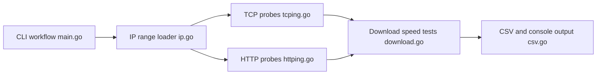

# XIU2/CloudflareSpeedTest

> Command-line program that measures the latency and throughput of a CDN's IPs to pick the fastest one.

## The problem
From mainland China, the Cloudflare IPs assigned by default are slow and lose packets. Finding a good IP among all the published ranges is tedious.

## What it actually does
- Loads IP ranges (`ip.txt`, IPv4 and IPv6, or `-ip`), tests each one over TCP or HTTP, then filters on latency and loss.
- Then runs a download test on the fastest ones and ranks them by throughput.
- Can filter by node region code (Cloudflare, CloudFront, Fastly, Gcore, CDN77, Bunny) in HTTP mode.
- Writes the result to CSV; the intended use is to copy the chosen IP into the hosts file.

## How it is wired


## Trying it
```bash
wget -N https://github.com/XIU2/CloudflareSpeedTest/releases/latest/download/cfst_linux_amd64.tar.gz
tar -zxf cfst_linux_amd64.tar.gz
chmod +x cfst
./cfst
./cfst -tl 200 -dn 20
```

## Cost and gotchas
Free, standalone Go binary. The HTTP test can be likened to network scanning: use low concurrency (`-n`) on a server, otherwise you risk suspension by the host or rate limiting by Cloudflare. The default test address is not guaranteed.

## What it is not
Not a performance tool for your own network in Europe: its value comes from a routing situation specific to mainland China. Does not cover WARP (UDP). The README states that Cloudflare forbids use as a proxy and that the risk is borne by the user. README in Chinese.

## Alternatives
- CloudflareST-Rust: Rust rewrite of the same tool.
- masgzy/CloudflareST: fork that stayed in Go.
- hoseinnikkhah/CloudflareSpeedTest-English: version with English texts.

## For you
To ignore: the problem it solves (CDN routing from China) is irrelevant to a data/AI/MLOps profile outside that context, despite a mature and widely followed tool.
