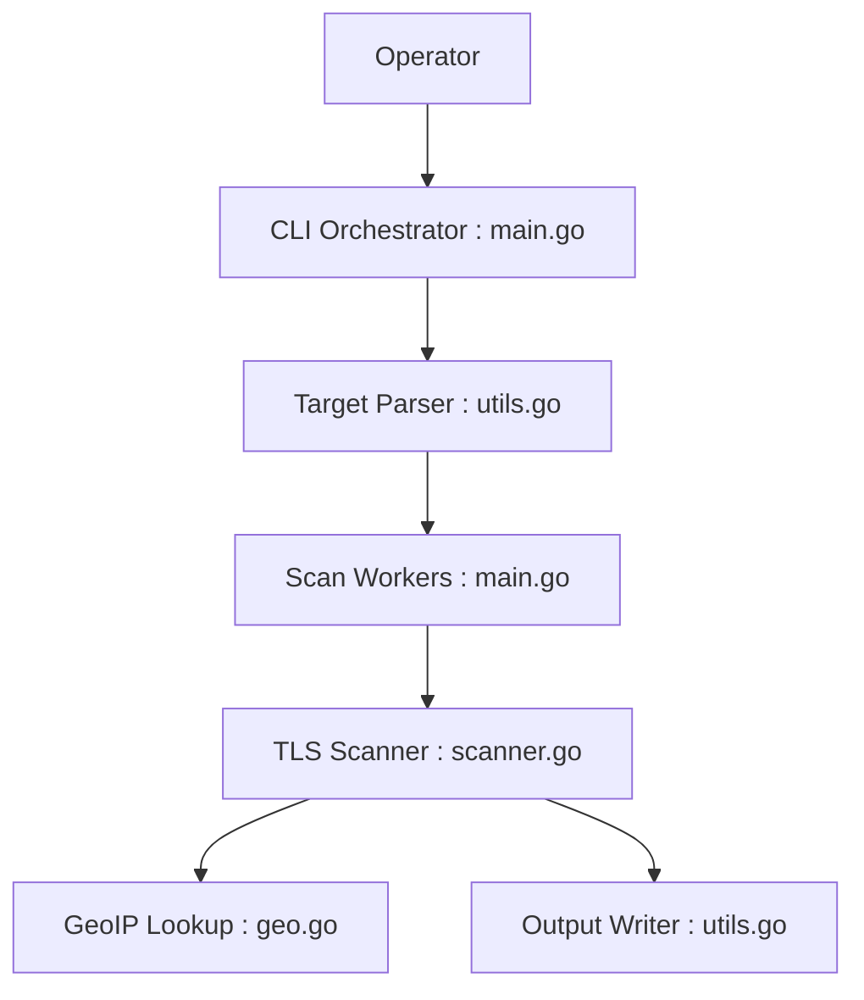

# XTLS/RealiTLScanner

> Command-line TLS scanner that finds hosts usable as targets for the Reality protocol.

## The problem
Finding TLS 1.3 servers with ALPN h2 in order to configure Reality (XTLS).

## What it actually does
Takes an address, a CIDR range, a domain, a file or a URL to crawl, resolves the targets, scans in parallel, reports the TLS version, ALPN, certificate domain and issuer, adds the country through an optional MaxMind database, and writes a CSV (`out.csv` by default).

## How it is wired


## Trying it
```bash
go build
./RealiTLScanner -addr 1.2.3.4
./RealiTLScanner -in in.txt -thread 10 -out file.csv
docker build -t realitlscanner .
```

## Cost and gotchas
Free. Go 1.21+. Run it locally: from a cloud VPS, the host risks being flagged. Scanning IP ranges requires having the right to do so. MPL-2.0 license (weak copyleft, per file).

## What it is not
Not a vulnerability scanner: it only reads out TLS parameters.

## Alternatives
No alternative named in the README.

## For you
Ignore: niche network tool tied to Reality/XTLS, unrelated to data/AI/MLOps.
