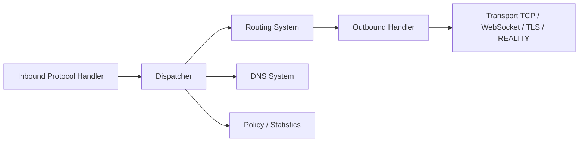

# XTLS/Xray-core

> Network and proxy toolkit from the XTLS protocol (Xray-core, REALITY), for network administrators.

## The problem
The README describes no problem: it is mostly an index of installers, web panels, graphical clients and examples.

## What it actually does
Xray-core, forked from v2fly-core, is a proxy core written in Go. According to the architecture: inbound and outbound handlers, protocols (VLESS, VMess, Shadowsocks, Trojan), transports (TCP, UDP, WebSocket, TLS, REALITY), routing, DNS, policies, statistics and observatory. The dispatcher connects inbounds to outbounds.

## How it is wired


## Trying it
```bash
brew install xray
CGO_ENABLED=0 go build -o xray -trimpath -buildvcs=false -ldflags="-s -w -buildid=" -v ./main
```

## Cost and gotchas
Free. Build with Go, or install via a Linux script, Docker or Homebrew; the panels and clients mentioned are third-party projects. The Windows package ships `wintun.dll` under its own license, redistributed as is. MPL-2.0: per-file copyleft.

## What it is not
Neither a turnkey VPN nor a tool documented for beginners: configuration goes through the external documentation.

## Alternatives
- No alternative named in the README.

## For you
Ignore: a network proxy tool with no link to a data/AI/MLOps workflow, and a README that serves only as an index.
