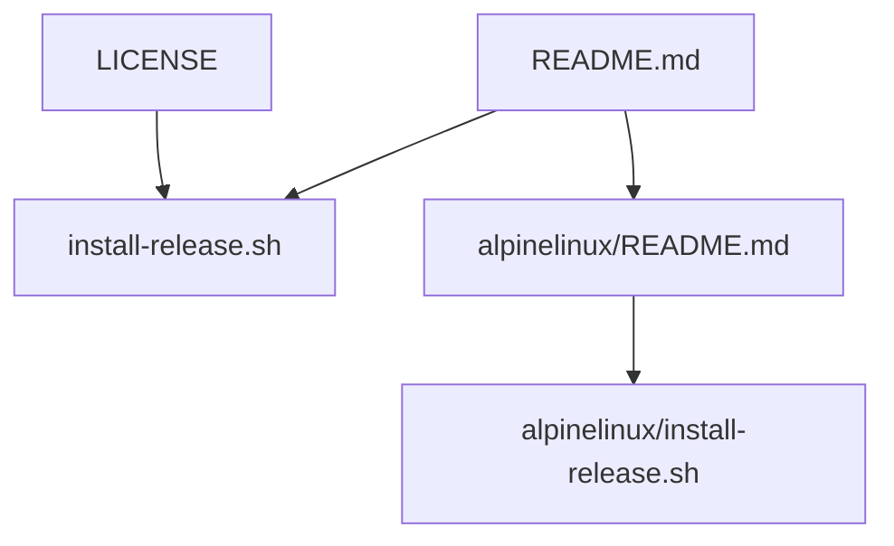

# XTLS/Xray-install

> Bash script that installs, updates and removes Xray-core on systemd-based Linux.

## The problem
Installing Xray by hand (binary, service, permissions, geographic data) is tedious and easy to get wrong.

## What it actually does
- Installs or updates Xray-core, with version, beta and local installation options.
- Creates the systemd service and a dedicated `xray` user.
- Updates GeoIP and GeoSite, enables log rotation.
- A variant exists for Alpine and Gentoo (OpenRC).

## How it is wired


## Trying it
```bash
bash -c "$(curl -L https://github.com/XTLS/Xray-install/raw/main/install-release.sh)" @ install
bash -c "$(curl -L https://github.com/XTLS/Xray-install/raw/main/install-release.sh)" @ update-geodata
bash -c "$(curl -L https://github.com/XTLS/Xray-install/raw/main/install-release.sh)" @ remove
```

## Cost and gotchas
Free, GPL-3.0. Breaking changes since 2026-10-18 (geodata source, `xray` user, permissions). The script is downloaded and run directly, with root rights.

## What it is not
Not Xray itself: only its installer. It does not configure any proxy for you.

## Alternatives
No alternative named in the README.

## For you
Ignore: without a need for a network proxy, it has no connection to your data / AI pipelines.
