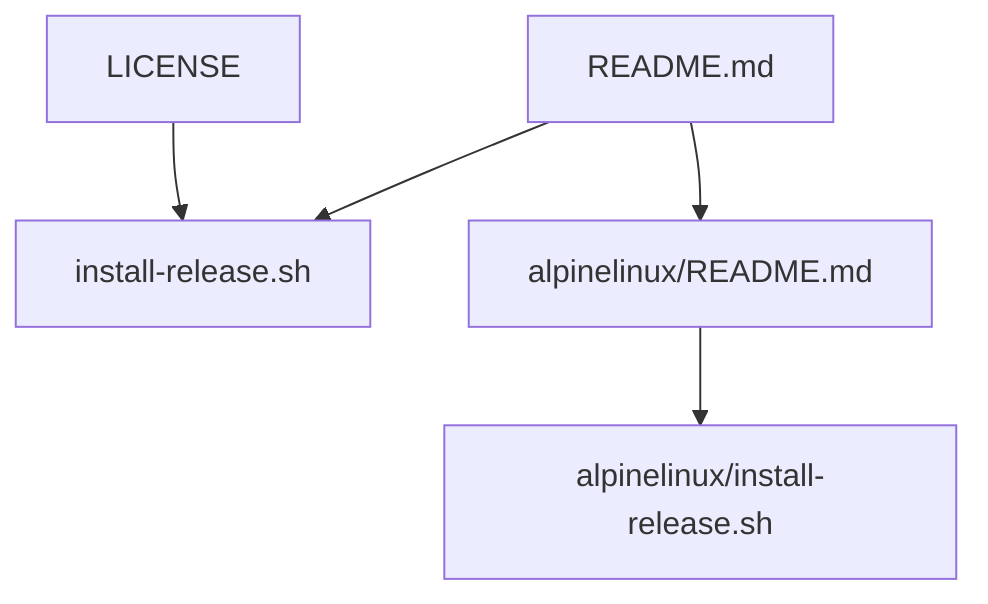

# XTLS/Xray-install

> Script Bash qui installe, met à jour et supprime Xray-core sur les Linux à systemd.

## Le problème
Installer Xray à la main (binaire, service, droits, données géographiques) est fastidieux et facile à mal faire.

## Ce que ça fait vraiment
- Installe ou met à jour Xray-core, avec options de version, bêta et installation locale.
- Crée le service systemd et un utilisateur dédié `xray`.
- Met à jour GeoIP et GeoSite, active la rotation des logs.
- Une variante existe pour Alpine et Gentoo (OpenRC).

## Comment c'est branché


## Essayer
```bash
bash -c "$(curl -L https://github.com/XTLS/Xray-install/raw/main/install-release.sh)" @ install
bash -c "$(curl -L https://github.com/XTLS/Xray-install/raw/main/install-release.sh)" @ update-geodata
bash -c "$(curl -L https://github.com/XTLS/Xray-install/raw/main/install-release.sh)" @ remove
```

## Coût et pièges
Gratuit, GPL-3.0. Changements incompatibles depuis le 2026-10-18 (source de géodonnées, utilisateur `xray`, permissions). Le script se télécharge et s'exécute en direct, avec les droits root.

## Ce que ce n'est pas
Pas Xray lui-même : seulement son installateur. Il ne configure aucun proxy à ta place.

## Alternatives
Aucune alternative nommée dans le README.

## Pour toi
À ignorer : sans besoin de proxy réseau, il n'a aucun rapport avec tes chaînes data / IA.

