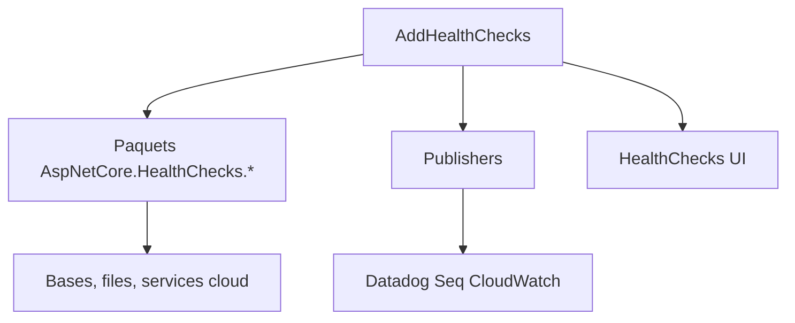

# Xabaril/AspNetCore.Diagnostics.HealthChecks

> Collection of ASP.NET Core packages that check the health of databases, queues and cloud services.

## The problem
Knowing whether an ASP.NET Core application can reach its database, cache or broker takes as many checks as there are dependencies.

## What it actually does
One NuGet package per service (SQL Server, Postgres, Redis, Kafka, RabbitMQ, MongoDB, Qdrant, Milvus, AWS, Azure…), added via `AddHealthChecks().AddXXX()`. "Publishers" send reports to Application Insights, Datadog, Seq, CloudWatch or Prometheus, plus a UI, Docker images and a Kubernetes operator. The README is truncated here after the Prometheus section.

## How it is wired
Simplified diagram based on the sheet, no diagram provided.



## Trying it
```csharp
services.AddHealthChecks()
    .AddSqlServer(Configuration["Data:ConnectionStrings:Sql"])
    .AddRedis(Configuration["Data:ConnectionStrings:Redis"]);
```
Preceded by `Install-Package AspNetCore.HealthChecks.SqlServer`.

## Cost and gotchas
Free. The Prometheus Gateway publisher is marked deprecated. Connectors to Azure, AWS or GCP require their own accounts and credentials.

## What it is not
Not a full monitoring tool: it exposes statuses, it does not replace Prometheus or Datadog. Older .NET versions (2.2 to 3.1) require older package versions.

## Alternatives
No alternative named in the README.

## For you
Keep an eye on it: useful if your inference services are in ASP.NET Core; it can already probe Qdrant and Milvus. Otherwise off topic.
