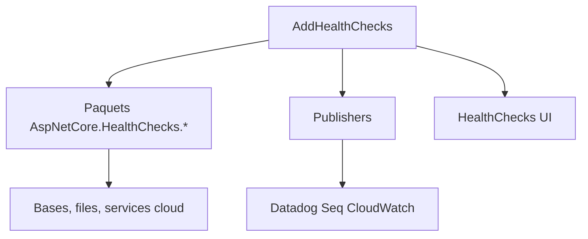

# Xabaril/AspNetCore.Diagnostics.HealthChecks

> Collection de paquets ASP.NET Core qui vérifient l'état de bases, files et services cloud.

## Le problème
Savoir si une application ASP.NET Core peut joindre sa base, son cache ou son broker demande autant de vérifications que de dépendances.

## Ce que ça fait vraiment
Un paquet NuGet par service (SQL Server, Postgres, Redis, Kafka, RabbitMQ, MongoDB, Qdrant, Milvus, AWS, Azure…), ajouté via `AddHealthChecks().AddXXX()`. Des « publishers » envoient les rapports à Application Insights, Datadog, Seq, CloudWatch ou Prometheus, plus une UI, des images Docker et un opérateur Kubernetes. Le README est tronqué ici après la section Prometheus.

## Comment c'est branché
Schéma simplifié d'après la fiche, sans diagramme fourni.



## Essayer
```csharp
services.AddHealthChecks()
    .AddSqlServer(Configuration["Data:ConnectionStrings:Sql"])
    .AddRedis(Configuration["Data:ConnectionStrings:Redis"]);
```
Précédé de `Install-Package AspNetCore.HealthChecks.SqlServer`.

## Coût et pièges
Gratuit. Le publisher Prometheus Gateway est marqué déprécié. Les connecteurs vers Azure, AWS ou GCP exigent leurs propres comptes et identifiants.

## Ce que ce n'est pas
Pas un outil de supervision complet : il expose des états, il ne remplace pas Prometheus ni Datadog. Les versions .NET anciennes (2.2 à 3.1) demandent d'anciennes versions des paquets.

## Alternatives
Aucune alternative nommée dans le README.

## Pour toi
À surveiller : utile si tes services d'inférence sont en ASP.NET Core ; il sait déjà sonder Qdrant et Milvus. Sinon hors sujet.

