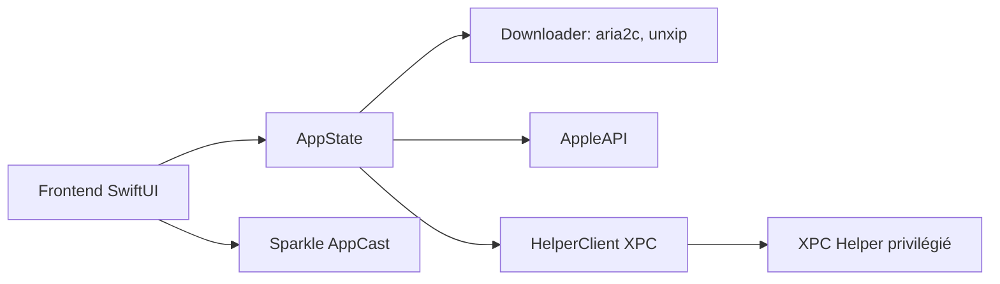

# XcodesOrg/XcodesApp

> macOS application for installing and switching between multiple Xcode versions.

## The problem
Installing, keeping and switching Xcode versions by hand is slow and error-prone.

## What it actually does
Lists available versions (Xcode Releases data or the Apple developer site) and installs end to end, using `aria2` to download over multiple connections and `unxip` for extraction. Automatic resume after a network error, activation of a version via `xcode-select`, installation of platforms and runtimes, Apple Silicon variants. Privileged operations go through an XPC helper.

## How it is wired


## Trying it
```bash
brew install --cask xcodes
```
Or download `Xcodes.zip` from the releases page and move it to `/Applications`.

## Cost and gotchas
Free, but an Apple ID is required to download Xcode. Versions 2.x and 3.x require macOS 13. Building the app requires macOS and Xcode 26. Changing the version of the XPC helper requires the user to reinstall it.

## What it is not
It is not a version manager for anything other than Xcode. The README mentions a separate command-line version, `xcodes`.

## Alternatives
`xcodes` (CLI): same role in the terminal, cited by the README.

## For you
Ignore: utility for Apple developers, of no interest for data/AI/MLOps work.
