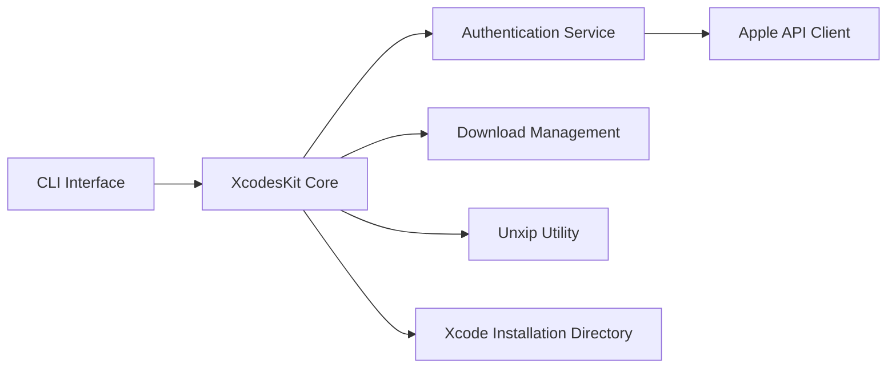

# XcodesOrg/xcodes

> macOS command line to install and switch between multiple Xcode versions.

## The problem
Downloading, unpacking and selecting several Xcode versions by hand is slow, especially on CI runners.

## What it actually does
A Swift CLI authenticates with Apple (credentials stored in the keychain), downloads the archives (aria2 if present), unpacks them (experimental unxip option), moves them to `/Applications` and selects the version. It also manages simulator runtimes and a `.xcode-version` file.

## How it is wired


## Trying it
```bash
brew install xcodesorg/made/xcodes
xcodes install 10.2.1
xcodes install --latest --experimental-unxip
xcodes list --architecture arm64
xcodes runtimes install "iOS 17.0-beta1"
```

## Cost and gotchas
Free, but an Apple Developer account is required; credentials via `XCODES_USERNAME` and `XCODES_PASSWORD`. The superuser password is requested at the end of the installation.

## What it is not
Not a manager for Linux: macOS only. The "best" qualifier in the README is a slogan.

## Alternatives
- Xcodes.app: the application version, mentioned in the README.
- xcode-install and fastlane/spaceship: credited as sources of inspiration.

## For you
Ignore: a macOS workstation tool for Apple developers, of no interest for a data/AI pipeline.
