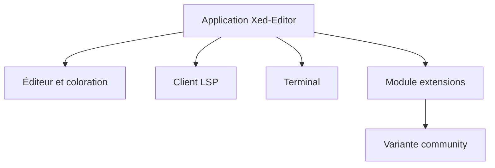

# Xed-Editor/Xed-Editor

> Extensible text editor for Android, with syntax highlighting, LSP, an integrated terminal and extensions.

## The problem
Editing code on a phone or tablet with real tools, not a simple notepad.

## What it actually does
Syntax highlighting, code intelligence through LSP, an embedded terminal and project tools. Two variants: community (extensions included; GitHub, F-Droid, IzzyOnDroid) and playstore (no extension store, arm64 Ubuntu rootfs embedded). The website hosts the documentation, themes and extensions.

## How it is wired
Simplified diagram based on the sheet, no diagram provided.


## Trying it
```bash
./gradlew assembleCommunityDebug
./gradlew assemblePlaystoreRelease
DOCKER_BUILDKIT=1 docker build --target export-stage --output ./out .
```

## Cost and gotchas
Free. Building requires the Android SDK and JDK 21 (or Docker). The Play Store variant only supports arm64-v8a. GPL-3.0 license.

## What it is not
Not a full development environment: the terminal relies on a downloaded or embedded Linux rootfs.

## Alternatives
No alternative named in the README.

## For you
Ignore: a mobile editor of little use for data or AI, except for quickly fixing a script while on the move.
