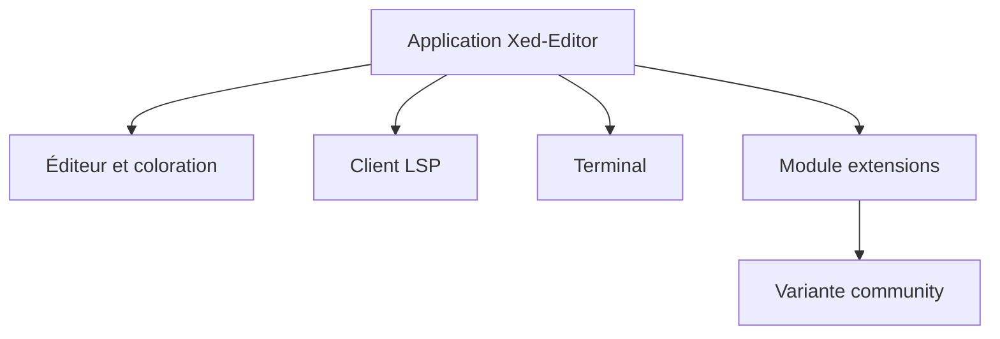

# Xed-Editor/Xed-Editor

> Éditeur de texte extensible pour Android, avec coloration, LSP, terminal intégré et extensions.

## Le problème
Éditer du code sur téléphone ou tablette avec de vrais outils, pas un simple bloc-notes.

## Ce que ça fait vraiment
Coloration syntaxique, intelligence de code par LSP, terminal embarqué et outils de projet. Deux variantes : community (extensions incluses, GitHub, F-Droid, IzzyOnDroid) et playstore (sans boutique d'extensions, rootfs Ubuntu arm64 embarqué). Le site héberge la documentation, les thèmes et les extensions.

## Comment c'est branché
Schéma simplifié d'après la fiche, sans diagramme fourni.


## Essayer
```bash
./gradlew assembleCommunityDebug
./gradlew assemblePlaystoreRelease
DOCKER_BUILDKIT=1 docker build --target export-stage --output ./out .
```

## Coût et pièges
Gratuit. Compiler demande le SDK Android et JDK 21 (ou Docker). La variante Play Store ne prend en charge que arm64-v8a. Licence GPL-3.0.

## Ce que ce n'est pas
Pas un environnement de développement complet : le terminal repose sur un rootfs Linux téléchargé ou embarqué.

## Alternatives
Aucune alternative nommée dans le README.

## Pour toi
À ignorer : éditeur mobile peu utile pour de la data ou de l'IA, sauf dépannage rapide d'un script en déplacement.

