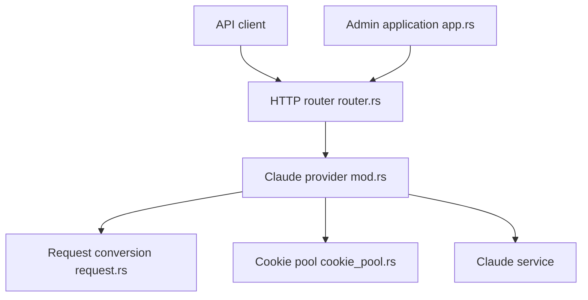

# Xerxes-2/clewdr

> Single-binary Rust proxy that exposes Claude.ai and Claude Code through Claude-compatible and OpenAI-compatible APIs.

## The problem
OpenAI-compatible clients (SillyTavern, Continue, Cursor) do not talk directly to Claude's web interface. A gateway is needed.

## What it actually does
It receives requests in native Claude or OpenAI formats, converts them, then sends them to Claude.ai or Claude Code using cookies you submit. A cookie pool chooses which one to use and displays their quota. A password-protected web admin interface manages cookies and configuration. The README claims less than 10 MB of RAM.

## How it is wired


## Trying it
```bash
curl -L -O https://github.com/Xerxes-2/clewdr/releases/latest/download/clewdr-linux-x86_64.zip
unzip clewdr-linux-x86_64.zip
chmod +x clewdr
./clewdr
```
Then open `http://127.0.0.1:8484` with the password shown in the console.

## Cost and gotchas
You need at least one Claude.ai cookie exported from the browser, so a Claude account and its quota. With Docker, mount `/etc/clewdr`, otherwise passwords are lost each time the container is recreated.

## What it is not
It is not an official API: it depends on the web interface and session cookies, which may break or violate the service's terms. The README says nothing about this. No management of Anthropic API keys.

## Alternatives
No named alternative in the README.

## For you
Watch: useful for connecting OpenAI-compatible clients to a Claude subscription, but fragile and risky regarding terms of use, so not for production.
