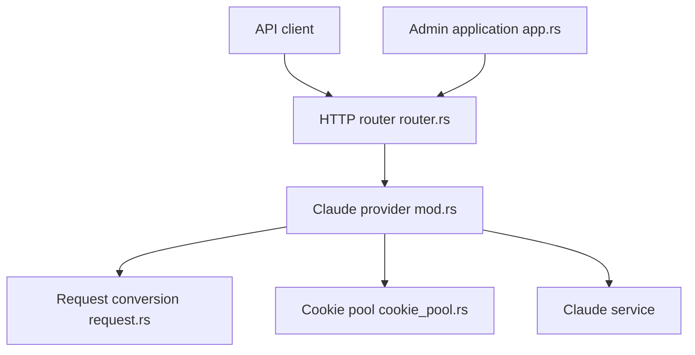

# Xerxes-2/clewdr

> Proxy Rust à binaire unique qui expose Claude.ai et Claude Code via des API compatibles Claude et OpenAI.

## Le problème
Les clients OpenAI-compatibles (SillyTavern, Continue, Cursor) ne parlent pas directement à l'interface web de Claude. Il faut une passerelle.

## Ce que ça fait vraiment
Il reçoit des requêtes aux formats Claude natif ou OpenAI, les convertit, puis les envoie à Claude.ai ou Claude Code avec des cookies que vous soumettez. Un pool de cookies choisit lequel utiliser et affiche leur quota. Une interface d'administration web protégée par mot de passe gère cookies et configuration. Le README annonce moins de 10 Mo de RAM.

## Comment c'est branché


## Essayer
```bash
curl -L -O https://github.com/Xerxes-2/clewdr/releases/latest/download/clewdr-linux-x86_64.zip
unzip clewdr-linux-x86_64.zip
chmod +x clewdr
./clewdr
```
Puis ouvrir `http://127.0.0.1:8484` avec le mot de passe affiché dans la console.

## Coût et pièges
Il faut au moins un cookie Claude.ai exporté du navigateur, donc un compte Claude et son quota. Avec Docker, monter `/etc/clewdr` sinon les mots de passe sont perdus à chaque recréation.

## Ce que ce n'est pas
Ce n'est pas une API officielle : il dépend de l'interface web et des cookies de session, ce qui peut casser ou contrevenir aux conditions du service. Le README ne dit rien là-dessus. Aucune gestion de clé d'API Anthropic.

## Alternatives
Aucune alternative nommée dans le README.

## Pour toi
À surveiller : utile pour brancher des clients OpenAI-compatibles sur un abonnement Claude, mais fragile et risqué côté conditions d'usage, donc pas pour de la production.

