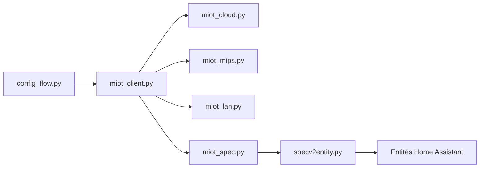

# XiaoMi/ha_xiaomi_home

> Official Xiaomi integration to control MIoT devices from Home Assistant.

## The problem
Xiaomi devices live in the Xiaomi Home app; you need a bridge to integrate them into Home Assistant.

## What it actually does
OAuth 2.0 connection to the Xiaomi account, import of the chosen devices, then creation of Home Assistant entities based on the MIoT-Spec-V2 specification (property → switch, sensor, number…). Control goes through the cloud (MQTT for events, HTTP for commands), or locally via the central gateway (mainland China only); a partial LAN mode is discouraged.

## How it is wired


## Trying it
```bash
cd config
git clone https://github.com/XiaoMi/ha_xiaomi_home.git
cd ha_xiaomi_home
./install.sh /config
```

## Cost and gotchas
Free, but a Xiaomi account is required. Tokens and certificates are stored in plain text in the Home Assistant configuration. Bluetooth, infrared and virtual devices are not supported. A license is present but not identified.

## What it is not
Not 100% local control: without a gateway, everything goes through the Xiaomi cloud.

## Alternatives
No alternative named in the README.

## For you
Outside the data/AI scope; only useful if you have a home Xiaomi fleet under Home Assistant.
