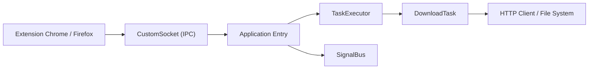

# XiaoYouChR/Ghost-Downloader-3

> Cross-platform download manager covering HTTP, BitTorrent, FTP, M3U8, DASH and eD2k, with a browser extension.

## The problem
Using five different tools to download files, torrents, video streams and repositories is tedious.

## What it actually does
Desktop application (Windows, macOS, Linux, Android) in Python and Qt: adaptive file splitting without merging, browser TLS fingerprints, YouTube, Bilibili, GitHub and Hugging Face parsers with mirror acceleration, aria2-compatible RPC. A Chrome/Firefox extension detects the media on the page and hands the download to the application through a local socket. Plugin system.

## How it is wired

## Trying it
The README contains no installation command: it points to the documentation and to the releases. No command reproduced.

## Cost and gotchas
Free, GPL-3.0 license. Qt 6.6+ requires a processor with AVX. Video downloads may violate platform terms.

## What it is not
Not a structured data collection tool: it is a generic downloader.

## Alternatives
yt-dlp, N_m3u8DL-RE and libtorrent, cited as components or references.

## For you
Worth watching: handy for fetching large models or datasets from Hugging Face with mirrors, but wget or huggingface-cli are often enough.
