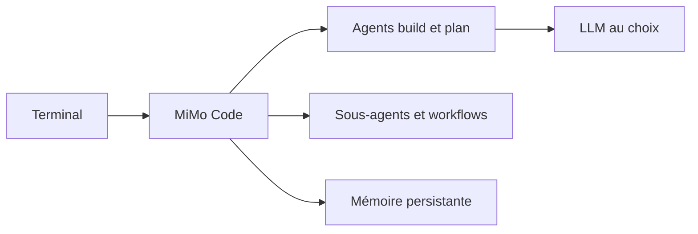

# XiaomiMiMo/MiMo-Code

> Terminal coding assistant with persistent memory, sub-agents and workflows, pluggable into most LLMs.

## The problem
Coding assistants lose context between sessions and struggle to hold long tasks without excessive cost.

## What it actually does
Terminal agent that reads and writes code, runs commands and manages Git. Project memory (SQLite FTS5), session checkpoints, tree-shaped task tracking, parallel sub-agents, `/goal` command with an independent judge, JavaScript workflows (deep-research, fact-check, research-experiment) and built-in skills. Connects to Xiaomi MiMo, Codex, Claude Code or any OpenAI-compatible API. A desktop application uses it as its engine. README truncated.

## How it is wired
Simplified diagram based on the sheet, no diagram provided.


No diagram provided. The README describes build and plan agents, memory, sub-agents, workflows and skills. Not documented in detail.

## Trying it
```bash
curl -fsSL https://mimo.xiaomi.com/install | bash
mimo
mimo serve --port 4096
```

## Cost and gotchas
Free on the tool side, but you pay the chosen model provider or connect through OAuth. The `curl | bash` install script should be inspected. The default macOS terminal is not supported. The mode without permission prompts is dangerous.

## What it is not
Not limited to Xiaomi models. Voice input and some features depend on the MiMo platform. More than 1,000 open issues.

## Alternatives
- Cursor, Cline, Zed: other tools where MiMo models also work.

## For you
Worth watching: a complete coding agent with persistent memory, to compare with your current tool before migrating.
