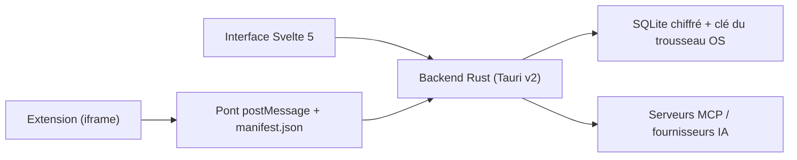

# Xoshbin/asyar

> Open source application launcher in Tauri and Rust, a Raycast alternative with AI agents and MCP.

## The problem
Popular launchers are either closed, heavy, or require an account. This one aims to be a local, lightweight and extensible launcher.

## What it actually does
App and file search, clipboard history, snippets, window management, shell scripts. It adds AI agents with tool calling (OpenAI, Anthropic, Ollama, etc., with your own key) and MCP support. Extensions run in isolated iframes with permissions declared in `manifest.json`.

## How it is wired
Simplified diagram based on the sheet, no diagram provided.



## Trying it
```bash
curl -fsSL https://raw.githubusercontent.com/Xoshbin/asyar/main/install.sh | sh
brew tap Xoshbin/asyar
brew install --cask asyar
```

## Cost and gotchas
Free, but the AI agents use your provider key. On Linux, Wayland is not supported for global shortcuts (workaround via `asyar-summon`).

## What it is not
Not a full equivalent of Raycast: the README benchmarks are measured by the author on a single Mac. The README is cut off before the end, some parts were not read.

## Alternatives
- Raycast: larger ecosystem, but closed and requires an account.
- Alfred: mature, but macOS only.

## For you
Watch: ergonomic for an AI profile that wants local agents, but a young project with a single maintainer.
