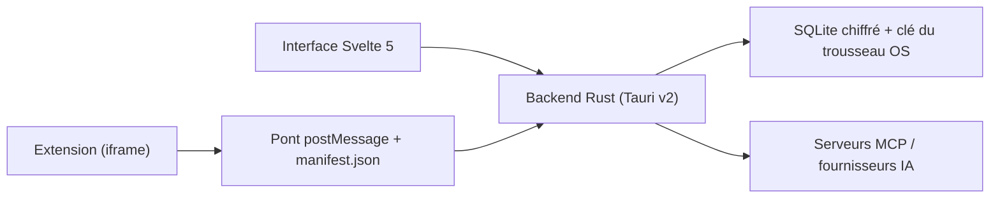

# Xoshbin/asyar

> Lanceur d'applications open source en Tauri et Rust, alternative à Raycast avec agents IA et MCP.

## Le problème
Les lanceurs populaires sont soit fermés, soit lourds, soit exigent un compte. Celui-ci vise un lanceur local, léger et extensible.

## Ce que ça fait vraiment
Recherche d'applications et de fichiers, historique du presse-papiers, snippets, gestion de fenêtres, scripts shell. Il ajoute des agents IA avec appel d'outils (OpenAI, Anthropic, Ollama, etc., avec ta propre clé) et le support MCP. Les extensions tournent dans des iframes isolées avec permissions déclarées dans `manifest.json`.

## Comment c'est branché
Schéma simplifié d'après la fiche, sans diagramme fourni.



## Essayer
```bash
curl -fsSL https://raw.githubusercontent.com/Xoshbin/asyar/main/install.sh | sh
brew tap Xoshbin/asyar
brew install --cask asyar
```

## Coût et pièges
Gratuit, mais les agents IA utilisent ta clé de fournisseur. Sous Linux, Wayland n'est pas supporté pour les raccourcis globaux (contournement via `asyar-summon`).

## Ce que ce n'est pas
Pas un équivalent complet de Raycast : les benchmarks du README sont mesurés par l'auteur sur un seul Mac. Le README est coupé avant la fin, certaines parties ne sont pas lues.

## Alternatives
- Raycast : écosystème plus large, mais fermé et avec compte.
- Alfred : mature, mais macOS seul.

## Pour toi
Surveiller : ergonomique pour un profil IA qui veut des agents locaux, mais projet à mainteneur unique et jeune.

