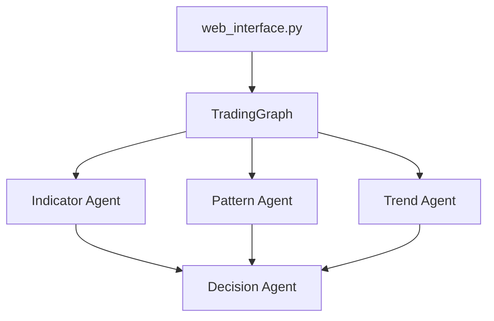

# Y-Research-SBU/QuantAgent

> Multi-agent LLM market analysis system, backed by a research paper on high-frequency trading.

## The problem
Manually reading indicators, price patterns and trend on an asset, then drawing a decision from them, is slow and subjective.

## What it actually does
Four agents, orchestrated with LangChain and LangGraph: Indicator (RSI, MACD, stochastic), Pattern (shape of the recent chart), Trend (trend channels) and Decision, which synthesizes into LONG or SHORT with entry, exit and stop-loss. Data comes from Yahoo Finance via yfinance, the last 30 candles, in a Flask web interface. An LLM that accepts images is required.

## How it is wired


## Trying it
```bash
conda create -n quantharness python=3.11
conda activate quantharness
pip install -r requirements.txt
export OPENAI_API_KEY="your_openai_api_key_here"
python web_interface.py
```

## Cost and gotchas
OpenAI, Anthropic, Qwen or MiniMax API key at your expense, with images sent for each analysis. TA-Lib sometimes installs poorly (conda-forge recommended).

## What it is not
It is not financial advice: the README states educational and research use. Nothing here proves trading performance; no quantified results are provided.

## Alternatives
No alternative is named in the README.

## For you
Worth watching: a good example of LangGraph agents with vision, useful for learning, but with no proof of profitability.
