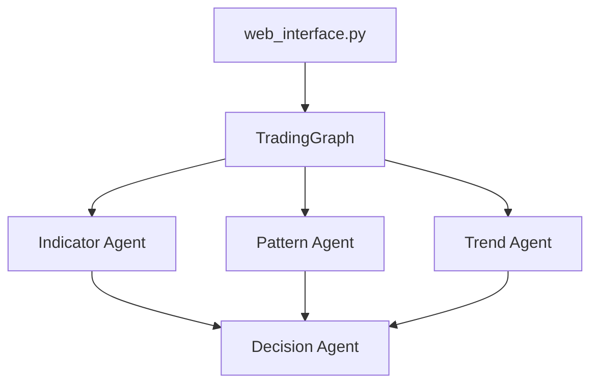

# Y-Research-SBU/QuantAgent

> Système multi-agents LLM d'analyse de marché, adossé à un article de recherche sur le trading haute fréquence.

## Le problème
Lire à la main indicateurs, figures de prix et tendance sur un actif, puis en tirer une décision, est lent et subjectif.

## Ce que ça fait vraiment
Quatre agents, orchestrés avec LangChain et LangGraph : Indicator (RSI, MACD, stochastique), Pattern (forme du graphique récent), Trend (canaux de tendance) et Decision, qui synthétise en LONG ou SHORT avec entrée, sortie et stop-loss. Les données viennent de Yahoo Finance via yfinance, les 30 dernières bougies, dans une interface web Flask. Un LLM acceptant les images est obligatoire.

## Comment c'est branché


## Essayer
```bash
conda create -n quantharness python=3.11
conda activate quantharness
pip install -r requirements.txt
export OPENAI_API_KEY="your_openai_api_key_here"
python web_interface.py
```

## Coût et pièges
Clé d'API OpenAI, Anthropic, Qwen ou MiniMax à ta charge, avec des images envoyées à chaque analyse. TA-Lib s'installe parfois mal (conda-forge conseillé).

## Ce que ce n'est pas
Ce n'est pas un conseil financier : le README précise usage éducatif et de recherche. Rien ne prouve ici une performance de trading ; aucun résultat chiffré n'est fourni.

## Alternatives
Aucune alternative n'est nommée dans le README.

## Pour toi
À surveiller : bon exemple d'agents LangGraph avec vision, utile pour apprendre, mais sans preuve de rentabilité.

